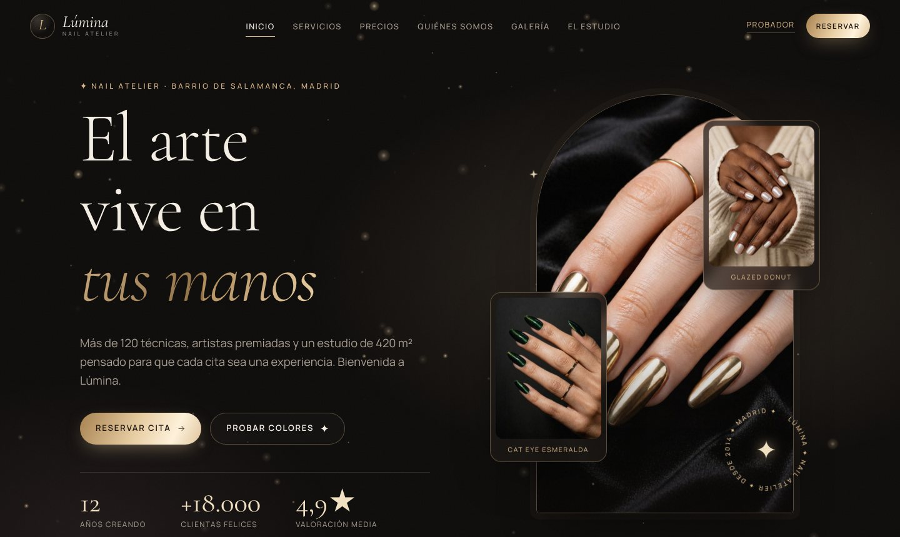

# Lúmina Nails · Nail Atelier

Web de un **salón de uñas y manicura de lujo** (ficticio) situado en el Barrio de Salamanca, Madrid.
Proyecto académico: el negocio, el nombre, el equipo, las opiniones y los precios son inventados.

### ✦ [Ver la web en directo](https://nivorakk.github.io/Manicura_WEB/)

[](https://nivorakk.github.io/Manicura_WEB/)

## Cómo verla

- **En internet:** [nivorakk.github.io/Manicura_WEB](https://nivorakk.github.io/Manicura_WEB/) (publicada con GitHub Pages).
- **En tu ordenador:** descarga el proyecto (**Code → Download ZIP**) y **abre `index.html` con doble clic** en
  cualquier navegador moderno (Chrome, Edge, Firefox o Safari). No hace falta instalar nada y funciona sin
  conexión a internet, porque las fotos y las tipografías están dentro del proyecto.

## Secciones

| Sección | Qué incluye |
|---|---|
| **Inicio** | Hero animado con partículas doradas, efecto de profundidad 3D con el ratón y cifras con contador |
| **Servicios** | 45 servicios en 7 categorías, tarjetas con inclinación 3D, explorador de formas de uña y diccionario de 42 técnicas con buscador |
| **Precios** | Carta de precios por categorías y **calculadora de presupuesto** con ticket animado |
| **Quiénes somos** | Historia, valores, línea temporal que se dibuja al hacer scroll y equipo |
| **Galería de trabajos** | 22 diseños con **filtros por estilo** y visor a pantalla completa (zoom, teclado y deslizar en móvil) |
| **El estudio** | 10 fotos del local (todas del mismo salón) en un recorrido con scroll horizontal |
| **Probador virtual** | Mano en SVG: 5 tonos de piel, 8 formas, largo, 48 colores y 8 acabados (brillo, mate, cromado, glitter, ojo de gato, francesa, baby boomer y aurora) |
| **Test de estilo** | 6 preguntas, 6 perfiles con paleta y servicios recomendados; carga el look en el probador |
| **Reservas** | 4 pasos: servicio, artista, **calendario con horas disponibles** y datos; confirmación con código y archivo `.ics` para el calendario |
| **Extras** | Opiniones, preguntas frecuentes, mapa, horario con «abierto ahora» y newsletter |

Todo está conectado: desde la galería, el probador, la calculadora o el test se puede reservar con los datos ya rellenos.

## Efectos e interacción

Preloader, cursor personalizado con estela de destellos, partículas doradas, títulos que aparecen palabra a palabra,
imágenes que se revelan, parallax, tarjetas 3D, botones magnéticos, cinta de técnicas en movimiento, confeti,
cabecera que se oculta al bajar, barra de progreso de lectura y menú móvil a pantalla completa.
Respeta la preferencia del sistema de **reducir movimiento** y es navegable con teclado.

## Tecnologías

- **HTML5, CSS3 y JavaScript** puros, sin frameworks ni librerías externas.
- Scripts clásicos (no módulos) para que la web funcione abriendo el archivo directamente.
- `localStorage` para guardar los looks del probador y las citas reservadas (simulado, no hay servidor).
- Tipografías Cormorant Garamond y Manrope (Google Fonts, licencia OFL) alojadas en `fonts/`.

## Estructura

```
index.html          Página única con todas las secciones
css/styles.css      Estilos (paleta de lujo oscuro, responsive)
js/data.js          Contenido editable: servicios, precios, galería, quiz, colores…
js/nail.js          Generador de formas de uña en SVG
js/effects.js       Efectos visuales y utilidades
js/servicios.js     Servicios, formas, diccionario y carta de precios
js/galeria.js       Galería con filtros, visor y recorrido del estudio
js/calculadora.js   Calculadora de presupuesto
js/probador.js      Probador virtual
js/quiz.js          Test de estilo
js/reservas.js      Reserva online
js/app.js           Arranque, equipo, opiniones y pie
img/                Fotos (versión grande y miniatura en /mini)
fonts/              Tipografías
```

## Créditos de las imágenes

- **Generadas con IA (Canva):** `cromado-champagne`, `micro-french`, `glazed-donut` y `cat-eye-esmeralda`.
- **El estudio:** las 10 fotos del local son de una misma serie del fotógrafo **Max Vakhtbovych** en Pexels
  (fotos 13068357, 13068359, 13068361, 13068362, 13068364, 13068369, 13068370, 13068373, 13068375 y 13068379).
- **Trabajos y proceso:** fotos de [Pexels](https://www.pexels.com) con licencia libre
  (36207029, 35031996, 18730147, 17010952, 17010955, 10420563, 12653044, 18706407, 10194068, 9649301,
  17280274, 939836, 15001865, 4963851, 7664093, 17471377, 34373403, 6262842, 3997391, 4677845, 22668324,
  3997386 y 19239100). Cada número corresponde a `https://www.pexels.com/photo/<número>/`.
